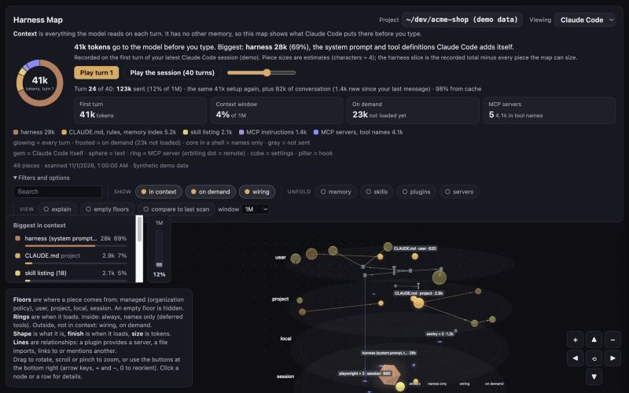

# claude-harness-map

An interactive 3D map of what your coding agent (Claude Code or Codex) loads into context before you type, and where each piece comes from.



[Live demo](https://mattkyuan.github.io/claude-harness-map/) (synthetic data)

## Why

Your config files are a small part of the context Claude Code actually sends. In one real session, CLAUDE.md, rules and the memory index came to about 6k tokens, while the first turn was 103k. Most of the rest was the harness itself: the system prompt plus definitions for the tools already loaded. This tool reads both your config and your session logs, so you can see the whole budget and trace each piece to its source.

## Set it up with Claude Code or Codex

Paste this into a Claude Code or Codex session started in the project you want to map:

```text
Clone https://github.com/mattkyuan/claude-harness-map into ~/tools/claude-harness-map,
or run git pull there if it already exists. It needs Node 18 or later and has no
dependencies, so do not run npm install. Then, from this project, run:

  node ~/tools/claude-harness-map/scan.mjs --project "$PWD" --out ~/tools/claude-harness-map/out

and tell me the full path of the harness-map.html it wrote, so I can open it in a browser.
Do not read or summarize the generated files: they describe my setup, and I will look
at the page myself.
```

- **Live page with Rescan and a folder picker:** `--serve` keeps running until you stop it. In Claude Code, ask for "the same command with `--serve`, run in the background, and give me the address it prints". In Codex, which waits for each command to finish, run that command yourself in a terminal. The address holds a private key, so open it yourself rather than pasting it anywhere.
- **Codex:** cloning needs network access and writing to `~/tools` is outside the project, so Codex may ask you to approve both.
- **Windows:** `~` is not expanded for `node` in PowerShell, so ask the agent to use the full path of your home folder.
- **Updating later:** ask the agent to run `git pull` in `~/tools/claude-harness-map`, then the same command.

## Run it

Requires Node 18 or later. The scanner has no dependencies; the page loads three.js from esm.sh, so viewing it needs a network connection.

From a clone or download of this repository:

```bash
node scan.mjs --project /path/to/your/project
```

Then open `out/harness-map.html` in a browser. It works from `file://`, online. Every harness set up on your machine is scanned; pick one from the Viewing dropdown.

| Flag | Meaning |
|---|---|
| `--recent <n>` | Also map the n folders you used Claude Code or Codex in most recently (from their session logs; worktrees count as their repo). Default 4 when no `--project` is given, 0 otherwise. |
| `--harness <id>` | `claude-code` or `codex`. Default: every harness set up on this machine |
| `--project <dir>` | Project to map. Default: current directory. Repeat it (`--project ~/a --project ~/b`) to map several into one page, picked from the Project dropdown. |
| `--session <file.jsonl>` | Transcript to read. Default: newest for the project |
| `--out <dir>` | Output directory. Default: `./out` |
| `--from <snapshot.json>` | Render an existing snapshot without scanning |
| `--share` | Write `harness-map-shared.html`, safe to post: every number and the shape of the map, with names, headings and paths replaced by "memory file 12", "MCP server 3" and so on. Works with `--from` too. Share that page, never the snapshot JSON files next to it. |
| `--serve` | Open the map at a local address with a **Rescan** button, and a folder picker on the project name (switch between mapped folders, or browse or type a path to map another), instead of writing a file to open. Folders added this way last until the server stops. Listens on 127.0.0.1 only, and the address carries a private key (kept in a cookie after the first visit), so other pages in your browser cannot read the map or start a scan. File sizes update on rescan; the first-turn total moves after you start a new session. `--port` picks the port (default 8766). Stop it with Ctrl+C. |

## Reading the map

- **Floors** are scopes, top to bottom: managed, user, project, local, session.
- **Rings** are load states. The two inner rings are in context: always loaded, then deferred tools (names only). The two outer rings are not: wiring such as settings and hooks, then on demand.
- **Context window bar**, beside the ranked list, shows how much of the window turn 1 fills. **Play turn 1** flies every in-context piece into it, in request order. Transcripts rarely record the window size, so it uses `autoCompactWindow` from your settings when set (Claude Code compacts against it), else 1M; pass `--window 200k` or switch it under Filters and options.
- **Size** is estimated tokens (characters / 4). Solid nodes are in context on the first turn. Outlines load only on demand; they are drawn at the size they would add when loaded.
- **Structure**: clicking a markdown file (CLAUDE.md, rules, skills, commands, agents) lists its headings with each section's token share. Picking MEMORY.md unfolds the files it links to; picking one of those (a hub) unfolds its links in turn. Files nothing links to stay in one group node that lists its 40 biggest. Link straight to a node with `#node=<id>`.
- **Domes**: unfolded files and server parts rise off their floor on a half-sphere (up for user and project, down for local and session). Files the parent links to directly spread evenly over it; deeper links sit just past the file that links to them. Floors move apart to clear the dome, and the camera pulls back to keep it in view.
- **MCP servers** say where they run (on your machine, remote, or unknown); remote ones carry an orbiting dot. Each server's on-demand use comes from your transcripts for this project over the last 30 days (`--usage-days N`, 0 to skip): calls, schema lookups and the tokens its results added per session, as a child node. A server nothing called fades. Only counts and dates are kept.
- **Skills and plugins unfold**: the skill listing splits into one node per skill with its share of the listing (a breakdown, so it never adds to the totals), and a plugin reveals the servers and skills it brings. Pills expand memory, skills, plugins or servers independently.
- **Connector names**: claude.ai connectors arrive named by UUID. The scanner infers a name from a shared tool prefix, the server's instructions, or what its tools do, and shows the source of the guess.
- **Labels** stay on for the 14 biggest nodes. Hover any node for its details.
- **MCP servers** start collapsed with their tools and instructions. Click one to expand it, or tick "expand servers".
- **Compare to last scan** colors nodes as new, grown, shrunk or unchanged since the previous run, and lists what was removed. Each scan keeps the last snapshot of the same project in `out/`.
- **The header** splits the first turn into tokens reused from cache and tokens that were new. Transcripts do not record the system prompt and tool schemas separately, so the harness node cannot be split further.
- **The bar** splits the first turn's context into harness, instructions, skill listing, MCP instructions and deferred tool names.
- **Explain** toggles plain-language explanations: the model is a sharp temp booked for one session. The onboarding binder (this map) is handed over when the session starts and reread before every reply, with the email thread so far; the next session gets a fresh temp with the same binder. CLAUDE.md is the team's how-we-work doc (advice), settings are IT policy and laptop locks (enforced), hooks are automatic compliance checks, deferred tools are apps on the laptop.

## What it reads

| Source | What is kept |
|---|---|
| `settings.json` at each scope | Keys, rule counts, hook events and matchers, the first word of each hook command, enabled plugins |
| CLAUDE.md, rules, skills, commands, agents | Name, path, size, and markdown headings with section sizes (`--no-outline` turns headings off). Walks parent folders and every subfolder, including nested `.claude/` folders in monorepos. Skips `node_modules`, `.git`, build output, virtualenvs and `.claude/worktrees`, and stops after 20,000 folders |
| `~/.claude.json` | MCP server names only. Nothing else is read from this file, which also holds credentials |
| Auto memory | Size of MEMORY.md, the tree of files it links to (names and sizes only, never link text), count and size of unlinked files |
| References | In every CLAUDE.md, rule, skill, command, agent and memory file: @imports (added to the map, since they load too), links and [[slug]] links to other pieces, plain-text mentions of a piece's file name or /command, and a count of links to other repo files |
| Newest session transcript | Which instruction files were injected, skill count, deferred tool names grouped by server, MCP instruction sizes, first-turn token total |

It never stores file contents beyond markdown headings, and never env values, permission rules or full hook commands. Snapshots stay in `out/`, which is gitignored. Memory and skill file names do appear in the map, so check before sharing a screenshot of your own.

## Caveats

- The first-turn total is recorded by the harness in its session log. Every piece's size is an estimate (characters / 4). The harness node is a remainder: recorded total minus every piece the map can size. When the estimates add up to more than the recorded total, the page says so.
- The page names the session it measured (model and date). It is the newest session in the project, including its worktrees, so with several sessions running at once it is whichever wrote last. Use `--session` to pin one.
- "Compare to last scan" can only show a change in the first turn if a new session started in between; the page says so when both scans read the same session.
- Session log formats are internal to each harness and undocumented. Fields can change between versions. The scanner treats every field as optional and falls back to config-only totals.
- The map shows one session's first turn. Context grows as tools are loaded and files are read.

## Build the demo

```bash
npm run demo
```

This regenerates `demo/snapshot.json` from `demo/make-demo.mjs` and renders `docs/index.html`.

## Codex

With both Claude Code and Codex set up, a plain scan maps both into one page with a "Viewing" dropdown in the title row (`?harness=codex` opens Codex directly). `--harness claude-code` or `--harness codex` maps just one. Each keeps its own last scan for "compare to last scan" (`snapshot.json`, `snapshot-codex.json`).

What the Codex scan reads, from `$CODEX_HOME` (default `~/.codex`):

- `config.toml`: MCP servers (with the same local or remote verdict, and `enabled = false` shown as disabled), enabled plugins, and the project's `.codex/config.toml` when the project is trusted.
- `hooks.json`, user and project.
- `AGENTS.md`: the global file, then one per folder from the git root down to the project (`AGENTS.override.md` wins in a folder).
- Skills in `~/.agents/skills` and the repo's `.agents/skills`.
- The newest native session rollout whose working folder is in the project: the system prompt, the skill listing, each note Codex adds before your prompt, and the first turn's token count and context window. Only sizes and tag names are kept, never the text.

Codex rollouts do not record tool schemas or MCP calls, so tool definitions sit in the harness remainder and the "not called lately" fade does not apply.

## Adding a harness

The scanner is split so other agent harnesses can be mapped with the same viewer:

- `scan.mjs` is the CLI: arguments, the snapshot file, the previous-scan comparison and the HTML.
- `lib/graph.mjs` holds the shared graph (`add`, `link`); `lib/util.mjs` the file helpers; `lib/mcp.mjs` the local or remote verdict for an MCP server; `lib/toml.mjs` a small TOML reader.
- `adapters/claude-code.mjs` and `adapters/codex.mjs` are the adapters. An adapter exports `id`, `name`, `detect()` (is this harness set up here?) and `scan({ projectDir, opt, graph })`, fills the graph with nodes (`scope`, `load`, `kind`, `tokens`) and returns `{ session, byLoad }`.
- The viewer takes harness-specific words (title, floor places, the instructions category) from `HARNESS_TEXT` in `viewer/index.html`, keyed by the snapshot's `harness.id`.

Register a new adapter in `ADAPTERS` in `scan.mjs`. A plain scan maps every adapter whose `detect()` is true; `--harness <id>` maps one. `npm test` runs each adapter against a synthetic home folder and checks that no secret, prompt text or home path reaches the snapshot.

## License

MIT. See [LICENSE](LICENSE).
